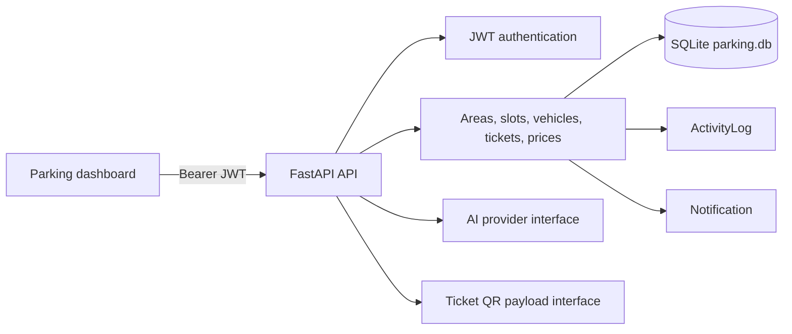
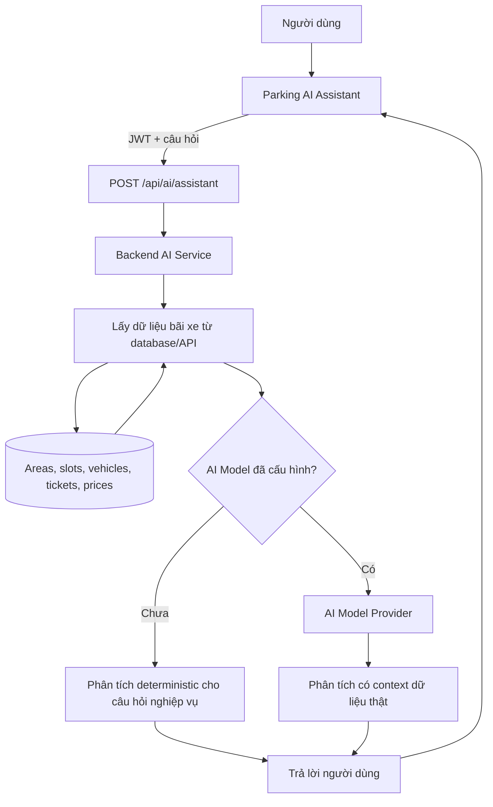

# Parking AI Architecture

## Current runtime

The active application is the `backend` directory: FastAPI, SQLAlchemy and SQLite. The HTML client is served by FastAPI at `/parking`. The `database/backend` tree is a legacy duplicate and is not used by the current launch configuration.

## Extension boundaries

## Parking AI request flow

The target product flow is:

Hiện tại `answer_parking_question()` là lớp phân tích deterministic cho các chỉ số đã xác định. Khi cấu hình đủ `AI_BASE_URL`, `AI_API_KEY` và `AI_MODEL`, `OpenAiCompatibleProvider` trong `backend/app/services/ai.py` sẽ đưa context đã truy vấn vào model; model không được tự tạo số liệu ngoài context. Nếu provider lỗi hoặc chưa cấu hình, hệ thống không giả vờ rằng model đã hoạt động.

- **Domain API:** existing areas, slots, vehicles, tickets and prices remain the source of truth.
- **Dashboard:** `/api/dashboard/summary` and `/api/revenue` calculate metrics from database rows. The browser refreshes the summary periodically so the first real-time version does not expose a token in an SSE query string.
- **Visualization:** parking cards are rendered from area/slot responses. A slot detail endpoint is available at `/api/slots/{slot_id}`.
- **Authorization:** accepted roles are `admin`, `manager`, and `staff`; legacy `employee` is treated as `staff`.
- **Audit:** `/api/audit-logs` reads `activity_logs`; ticket entry and exit currently create audit records.
- **Notifications:** `/api/notifications` reads database-backed notifications; ticket entry and exit create notifications from real events.
- **QR:** `/api/tickets/{ticket_id}/qr` returns a versioned payload for a QR renderer. No fake image is returned when no QR renderer is configured.
- **AI:** `/api/ai/assistant` handles supported factual questions from current database data. `/api/ai/capabilities` advertises integration state. `/api/ai/query` returns `501` until a real provider is configured. `app/services/ai.py` is the provider boundary for chatbot, analytics, forecast and license-plate recognition.
- **Backup:** `backup_database.py` and `restore_database.py` use SQLite's online backup API. Restore should be run with the application stopped and a verified backup path.

## Production migration path

1. Move SQLite to PostgreSQL behind the existing SQLAlchemy session boundary.
2. Add Alembic migrations before adding non-null business fields.
3. Replace polling with authenticated WebSocket/SSE transport when deployment supports connection authentication.
4. Add a real reservation table and state machine instead of overloading slot status.
5. Add a QR renderer/signing key and verify ticket payloads server-side.
6. Configure an AI provider through environment variables and keep provider calls isolated from domain writes.
7. Add rate limiting, secret management, HTTPS, CORS allowlists, structured logs and automated backups.

## Data constraints still requiring product decisions

The current schema has no phone number, floor, slot type, reservation entity, cancellation state or price effective dates. Those should be added through explicit migrations and business rules rather than inferred or filled with placeholder values.
